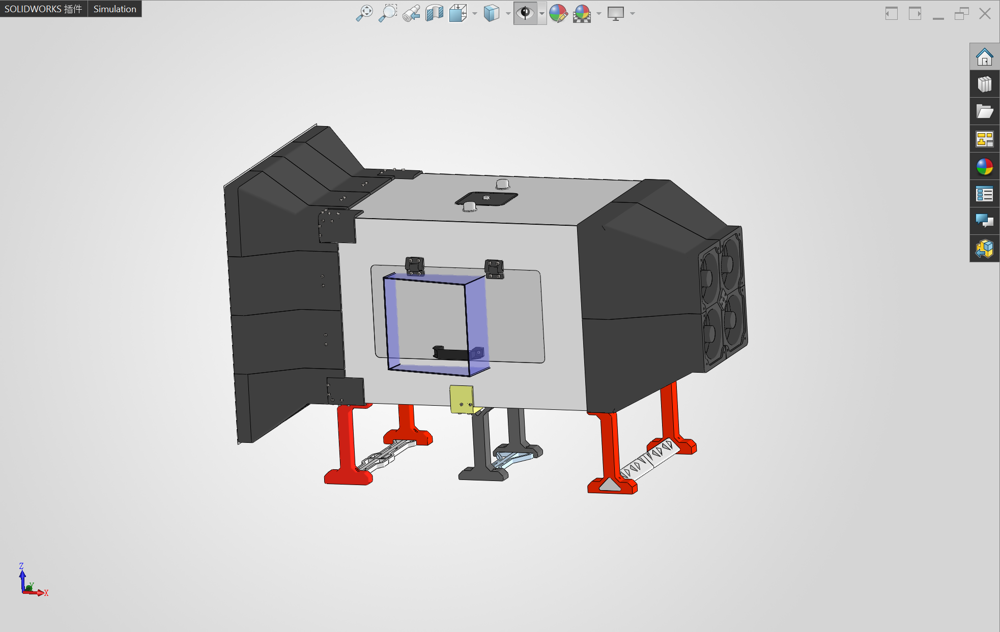
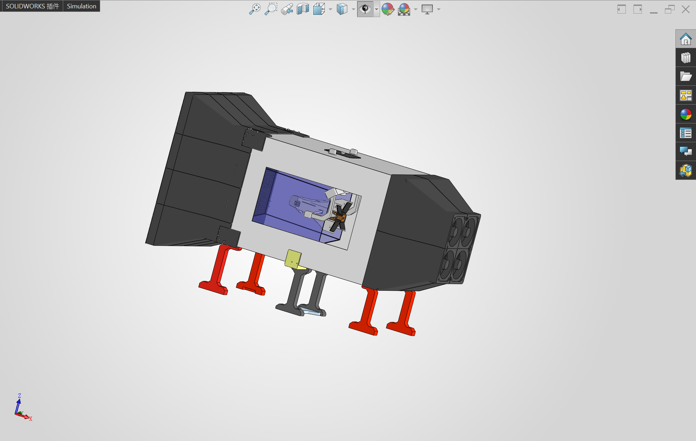
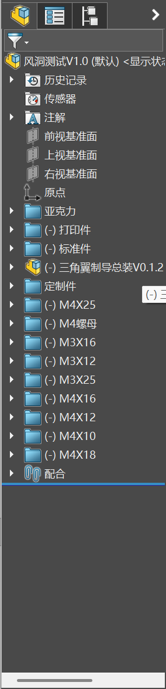

# 风洞测试 V1.0

用于 **27 赛季制导飞镖** 风洞测试的三维模型（SolidWorks），版本 V1.0。



## 项目说明

- 总装配体：`风洞测试V1.0.SLDASM`
- 用途：为制导飞镖提供可控气流的测试环境，配合 `镖体适配风洞测试.SLDPRT` 对镖体进行风洞实验。
- 软件：SolidWorks（`.SLDPRT` 零件 / `.SLDASM` 装配体）

## 前期调研与设计原理

### 前期调研

详细调研与记录见 [研发日志](研发日志/风洞V1.0/风洞V1.0.md)。


### 第一版方案选型

- 打印兼容：打印体积 **256 × 256 × 256 mm** 的打印机。
- 外壳防止翘曲：需依据实际情况调整打印参数或材料。


### 结构原理：开式回流型低速风洞

进气方式采用**开式回流型低速风洞**：来自房间的空气由风扇吸入风洞，在测试模型上加速、减速后自由排回房间，结构原理类似莱特兄弟最早使用的风洞。

气流依次经过以下组件：

1. **钟形入口** —— 空气由此进入风洞；
2. **蜂窝整流器** —— 校正气流方向、分解大尺度湍流；
3. **网格** —— 进一步分解逐渐减小的湍流尺度；
4. **空管道段** —— 让残余最小尺度湍流因粘度而自然衰减；
5. **收缩锥** —— 将气流挤压至更小截面（4:1 面积比），降压并加速到测试速度；
6. **测试段** —— 放置测试样品（模型），用于流动可视化或测量力、力矩、压力、剪切应力等；
7. **烟雾 / 激光片可视化** —— 在收缩锥上游注入烟雾，配合激光片照亮薄层气流，观察流线。

风洞草图（由四部分组成）：


> 10.31：受尺寸和材料限制，先完成核心调试结构与调试仓，前后置处理（前置涡流处理、后置处理）暂缓。



## 目录结构



```
风洞V1.0/
├── 风洞测试V1.0.SLDASM           # 总装配体
├── 风洞草图.SLDPRT                # 风洞设计草图
├── 镖体适配风洞测试.SLDPRT        # 镖体适配件
│
├── 亚克力件/                     # 亚克力板（测试区外壳）
│   ├── 亚克力-风洞测试V1.0-上板.SLDPRT
│   ├── 亚克力-风洞测试V1.0-下板.SLDPRT
│   ├── 亚克力-风洞测试V1.0-左板.SLDPRT
│   ├── 亚克力-风洞测试V1.0-右板.SLDPRT
│   ├── 亚克力-测试区外围.SLDPRT
│   ├── 亚克力-门板.SLDPRT
│   └── 亚克力-扩压板.SLDPRT
│
├── 定制件/                       # 不锈钢滤网（定制加工）
│   ├── 定制件_不锈钢304滤网_进气大网.SLDPRT
│   └── 定制件_不锈钢304滤网_出气小网.SLDPRT
│
├── 标准件/                       # 外购标准件
│   ├── 标准件-14cm220V散热风扇.SLDPRT
│   ├── 标准件_12mm220V风扇.SLDPRT
│   ├── 标准件-不锈钢滤网40目.SLDPRT
│   ├── 标准件-40mm连接件.SLDPRT
│   ├── 标准件-F6-11M-推力球轴承.SLDPRT
│   ├── 标准件-F8-14M-推力球轴承.SLDPRT
│   ├── 标准件-MF106ZZ-D10d6B3法兰轴承.SLDPRT
│   ├── 标准件-三轴云台YAW-8-14-4法兰轴承.SLDPRT
│   ├── 标准件-M4D6塞打螺丝L25.SLDPRT
│   ├── 标准件-M4D6塞打螺丝L50.SLDPRT
│   ├── 标准件-塞打螺丝M6XD8X20.SLDPRT
│   └── 标准件-阻尼铰链.SLDPRT
│
├── 打印件/                       # 3D 打印件
│   ├── 打印件-3轴支架-L型支架.SLDPRT
│   ├── 打印件-YAW轴叉架.SLDPRT
│   ├── 打印件-镖体固定架(.mirror).SLDPRT
│   ├── 打印件-stand.SLDPRT
│   ├── 打印件-stand-front(.mirror).SLDPRT
│   ├── 打印件-back底板(.右).SLDPRT
│   ├── 打印件-底板梁.SLDPRT
│   ├── 打印件_前梁底板(.左/.右).SLDPRT
│   ├── 打印件_后支撑件.SLDPRT
│   ├── 打印件-L型连接中间(.mirror/.mirror2).SLDPRT
│   ├── 打印件-L型连接角马(.右).SLDPRT
│   ├── 打印件-L型连接处保护套.SLDPRT
│   ├── 打印件-扩流安装板(.进风口_连接处/_出气口_mirror).SLDPRT
│   ├── 打印件-进气口扩流直板.SLDPRT
│   ├── 打印件_进气口直板(.上/.下/.X8 等).SLDPRT
│   ├── 打印件_进气口直板V2.0.SLDPRT
│   ├── 打印件-出风口.SLDPRT
│   ├── 打印件_风扇连接板.SLDPRT
│   ├── 打印件_风洞测试下板扩展.SLDPRT
│   ├── 打印件安装凸台.SLDPRT
│   ├── 打印件-光轴盖板(.左).SLDPRT
│   ├── 打印件_把手.SLDPRT
│   ├── 打印件-烟雾发生器柱塞.SLDPRT
│   └── 打印件-烟雾堵口.SLDPRT
│
├── CPU散热风扇/                  # 风源风扇装配体
│   ├── final.SLDASM
│   ├── casing.SLDPRT
│   ├── propeller.SLDPRT
│   ├── 打印件-扩流安装板-直板.SLDPRT
│   └── rendered.1.jpg
│
├── 研发日志/                     # 研发记录与前期调研
│   └── 风洞V1.0/
│       ├── 风洞V1.0.md            # 研发日志正文
│       └── 图片和附件/            # 日志配图
│
├── 照片/                         # 模型截图
│   ├── 模型照片.png
│   └── 文件夹结构.png
│
├── 风洞测试V1.0.zip              # 打包备份
└── CPU散热风扇.zip               # 风扇模型打包备份
```

## 零件分类说明

| 分类 | 说明 | 加工方式 |
|------|------|----------|
| 亚克力件 | 风洞测试区透明外壳（上/下/左/右板、门板、外围、扩压板） | 亚克力激光切割 |
| 定制件 | 不锈钢 304 滤网（进气大网、出气小网） | 定制加工 |
| 标准件 | 风扇、轴承、螺丝、铰链、滤网等外购件 | 外购 |
| 打印件 | 支架、底板、连接件、进气/扩流、烟雾等结构件 | 3D 打印 |

## 研发日志

- [风洞V1.0 研发日志](研发日志/风洞V1.0/风洞V1.0.md) —— 前期调研、方案选型、结构原理与调试记录。

## 注意事项

- 以 `~$` 开头的文件（如 `~$亚克力-门板.SLDPRT`）是 SolidWorks 打开时生成的**临时锁定文件**，请勿修改、上传或提交到版本管理，正常关闭软件后会自动清理。
- `*_mirror` / `*_mirror2` 为镜像零件，修改原零件时请确认是否需要同步更新镜像件。
- 修改后请及时更新 `风洞测试V1.0.zip` 打包备份，避免装配体引用路径变化导致缺件。

## 版本历史

- **V1.0**（2026-11）：首个完整版本，包含风洞主体、风源风扇、镖体适配件及烟雾通道相关结构。
- **V1.2**（2026-11-17）：完成第一版打印件的建模。装配上出现了一些问题：打印件装配次序未分清、轴系设计公差未给好、风扇风力不足需更换风源方案。后续更新研发和调研日志。优化方向：更换风源；增加风速传感器；开始尝试参数化 CFD 仿真调试。
