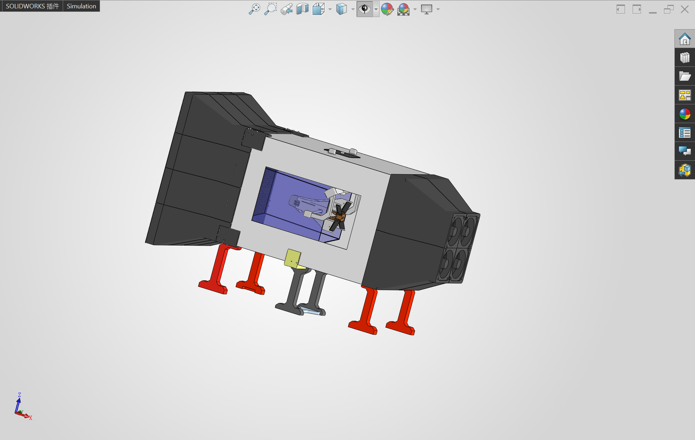

# 风洞V1\.0

前期调研：

### 1\.第一版方案选型：确定打印机尺寸：打印体积为256x256x256 mm的打印机兼容

外壳为了防止翘曲，需要依据实际情况改变打印的参数或者材料

1\.结构原理：进气方式：开式回流型低速风洞，来自房间的空气由风扇吸入风洞在测试模型上加速，减速，并自由地排出到房间中。进气风洞只是一个简单的概念，其结构类似于奥维尔和莱特兄弟使用的最早的风洞

当空气进入**钟形入口**并进入风洞时，首先由一组“流动调节”组件进行处理：**蜂窝整流器**用于校正气流并分解大尺度湍流，一组网**格**分解逐渐减小的湍流尺度。**空管道段**然后进一步允许剩余的最小尺度湍流由于粘度而放松或衰减。

然后，气流被拉过一个**收缩锥**，它将气流挤压成较小的横截面（此处为4:1面积比），导致压力下降，同时加速到测试速度（可有）

气流然后进入**测试段**，其中放置各种**测试样品（或模型）**用于[流动可视化](https://en.wikipedia.org/wiki/Flow_visualization)或数据的测量（力、力矩、压力、剪切应力等）。在这个风洞中，烟雾或雾气线可以注入收缩锥的上游，在测试样品上产生[流线](https://en.wikipedia.org/wiki/Streamlines,_streaklines,_and_pathlines)。可视化可以通过**激光片**来辅助，激光片只照亮烟雾流的一薄层，从而隔离某些流动特征。

最后的风洞的草图大概长这样，由四个部分组成：

10\.31

经过我一周的思考，由于尺寸和材料的限制，先做核心的调试结构和调试仓，前置涡流的处理和后置的处理可以线不管。

目前等材料搭建中\.\.\.

